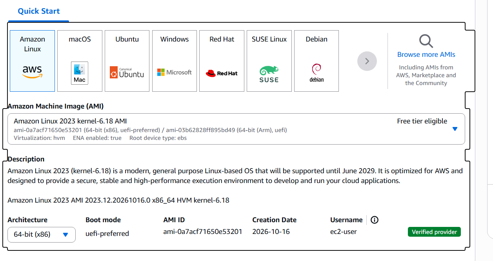
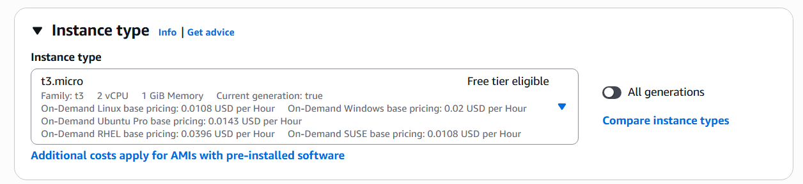
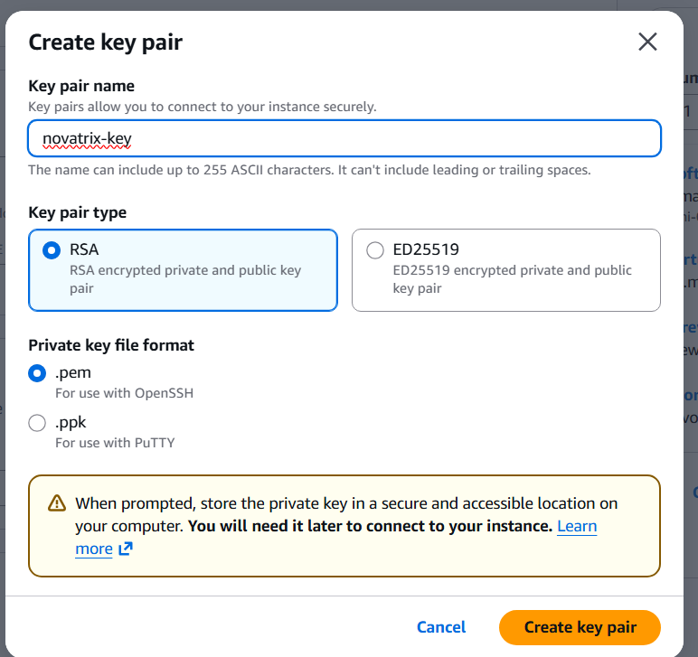
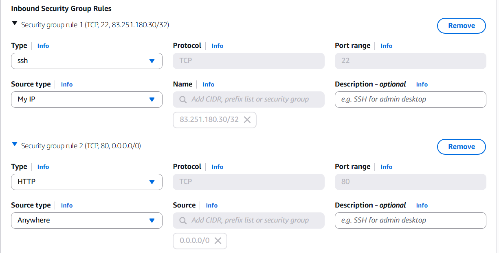
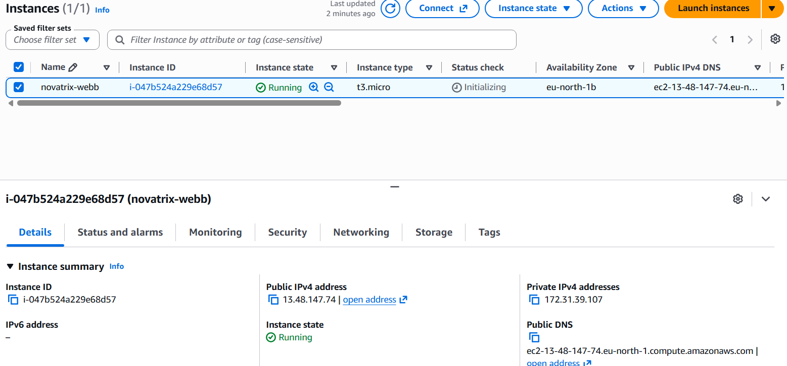
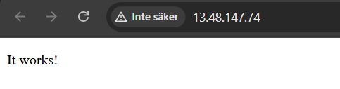
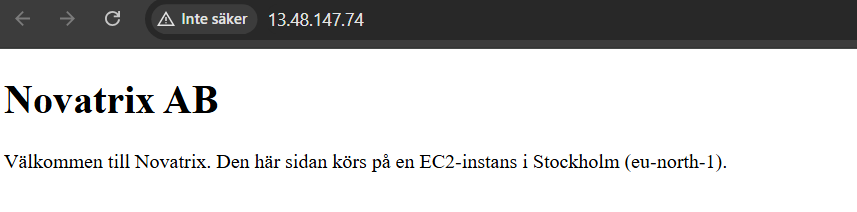

# AWS-mov25

Checka att du är irätt region samt om du söker på EC2 hittar du instancer som du kan launcha som fungerar somvåran vm



Viktigt att det är Free tier elegiable


Används för vilken typ av dator

Men innan detta skapa SSH key

Create new key pai under Key pair login sektionen
RSA och .pem

Kan lägga den i C:\Users\samue\.ssh för enkel lagring
Men jag la min i min azure app

## Security group


Tryck edit på network settings och ändra ssh
I vårat fall använder vi source type my IP 
samt en HTTP open for anywhere


Sen kan du trycka på launch instance
## instance



Kopiera IP vilket vi behöver sen ska vi konfigurera webbanslutnign

## SSH

Browsa till din mapp med SSH du har sparat i 

skriv seda
````powershell
icacls .\novatrix-key.pem /inheritance:r 
````
````powershell
 icacls .\novatrix-key.pem /grant:r "$($env:USERNAME):R"
````

````powershell
ssh -i .\novatrix-key.pem ec2-user@13.48.147.74
````
Står det någonting som ec2-user och sedan en IP har det fungerat.

är det andra problem gå till edit inbound rules och fixa my ip igen på våran SSH regel.

## Inne i datorn
````
sudo yum update -y
````

````
sudo yum install httpd -y
````

````
sudo systemctl start httpd
````
Checka status om du vill
````
sudo systemctl status httpd
````
````
sudo systemctl start httpd
````
````
sudo systemctl enable httpd
````
Om allting fungerar får du när du browsar in på HTTP och du får texten It works!


## Skapa enkel hemsida

````powershell
sudo bash -c 'echo "<!DOCTYPE html><html><head><meta charset=\"utf-8\"><title>Novatrix AB</title></head><body><h1>Novatrix AB</h1><p>Välkommen till Novatrix. Den här sidan körs på en EC2-instans i Stockholm (eu-north-1).</p></body></html>" > /var/www/html/index.html'
````

Ser ut såhär 


